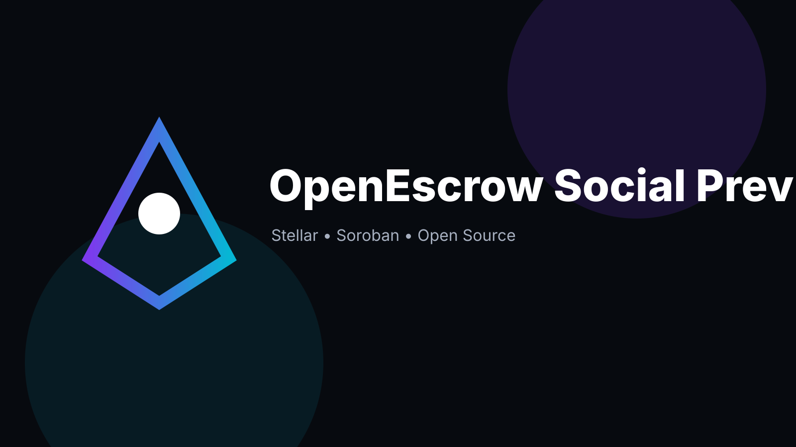

# OpenEscrow — openescrow-contracts

> Milestone escrow for services and deliverables.

## Role

This repository is one part of the **OpenEscrow** three-repository system. See the organization README for the dependency map.

## Maintainer

**Hikmaholadele** ([@Hikmaholadele](https://github.com/Hikmaholadele))

## Status

**v0.1.0 development baseline — not audited and not production-ready.**

## Stellar alignment

The project uses Stellar/Soroban where on-chain state is the source of truth or where deterministic settlement is valuable. Off-chain services are kept out of consensus-critical logic.

## License

Apache-2.0
